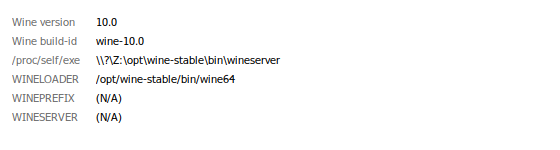

# WineInfo VST3

A diagnostic VST3 plugin that displays Wine environment information.



The editor is presented with Vulkan. Under Wine it requires Wine 10.0 or later, which supports Vulkan surfaces on child windows such as plugin editors.

## Building

### Prerequisites

This project uses Dev Container for building.

- [Dev Container CLI](https://github.com/devcontainers/cli)
- Docker or a compatible container runtime

### Build Steps

1. Build the dev container:

```bash
devcontainer build --workspace-folder .
```

2. Start the dev container:

```bash
devcontainer up --workspace-folder .
```

3. Configure the project:

```bash
devcontainer exec --workspace-folder . cmake --preset mingw-w64-x86_64
```

4. Build the plugin:

```bash
devcontainer exec --workspace-folder . cmake --build build --target wineinfo
```

The built plugin will be located at `build/VST3/Release/wineinfo.vst3/`. Copy the `wineinfo.vst3` folder to the VST3 plugin directory: `${WINEPREFIX}/drive_c/Program Files/Common Files/VST3/`

## Testing

`ui_harness` is a minimal VST3 host that loads the plugin under Wine, opens its editor in a top-level window, and checks that the view attaches, paints, and detaches. It also writes a screenshot of the editor to `build/ui_harness.bmp`.

1. Build the plugin and the harness:

```bash
devcontainer exec --workspace-folder . cmake --build build --target wineinfo ui_harness
```

2. Run the test on a virtual X display:

```bash
devcontainer exec --workspace-folder . xvfb-run -a ctest --test-dir build --output-on-failure
```

To inspect the editor by hand on a machine with a display, run the harness with `--interactive` and close the window to finish:

```bash
wine build/ui_harness.exe --interactive build/VST3/Release/wineinfo.vst3
```
